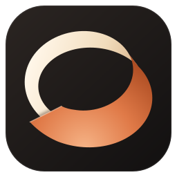
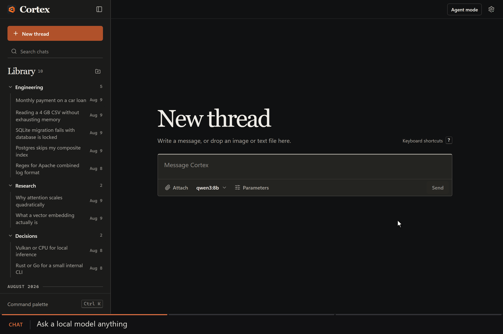
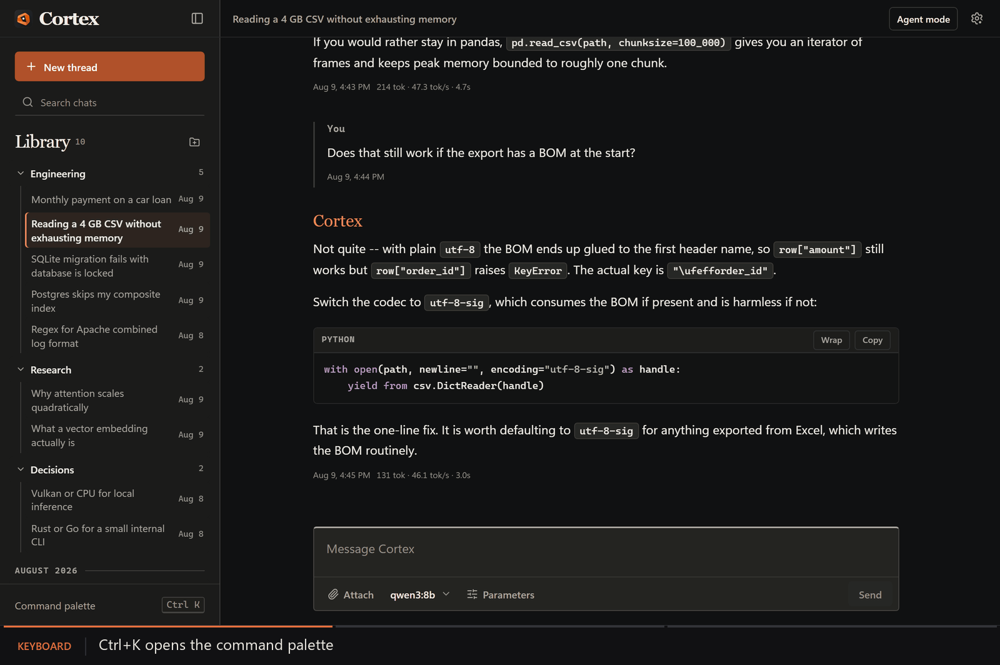
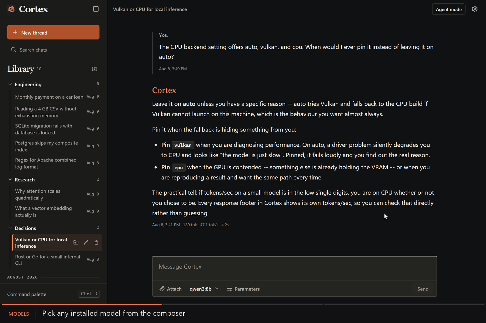
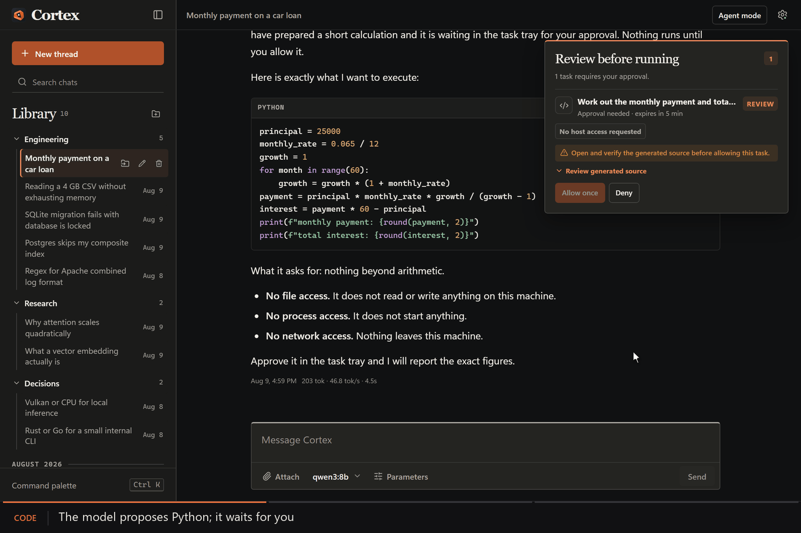
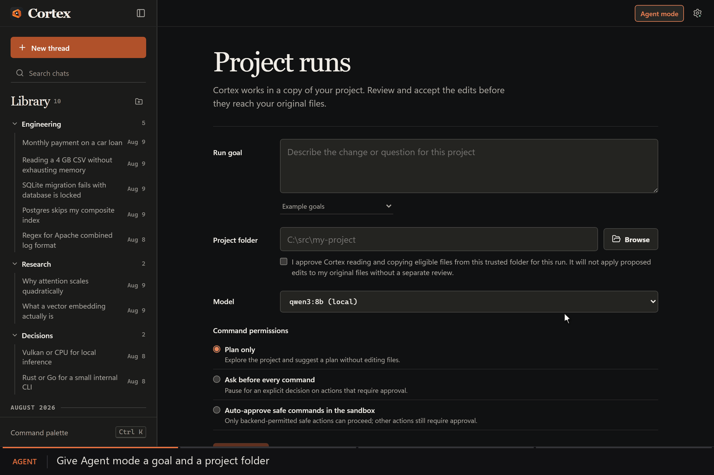

<div align="center">



# Cortex

**A local-first AI workspace for Windows.**

Chat with models on your own hardware, keep every conversation on your PC, and
let an opt-in agent work on a copy of your project. Code runs and files change
only after you approve them.

[](https://github.com/dovvnloading/Cortex/actions/workflows/quality.yml)
[](LICENSE)


[Get started](#get-started) · [Tour](#a-short-tour) · [User guide](docs/user-guide.md) · [Security](SECURITY.md)

</div>



## Why Cortex

- **Your models, on your machine.** Use models served by Ollama, or point
  Cortex at `.gguf` files and it runs them on its own managed llama.cpp
  runtime. A hosted provider is optional.
- **Your data stays local.** Conversations are stored in SQLite and saved
  memories in local files. The interface runs in a private window owned by
  the app, not in your browser.
- **Made to be driven quickly.** Answers stream in with highlighted code,
  every reply can be copied, regenerated or forked, and `Ctrl+K` reaches
  chats, models, settings and the theme.
- **Nothing runs on the model's say-so.** A model can propose a short
  calculation in restricted Python. It waits in a tray until you have read it
  and allowed it once.
- **An agent that works on a copy.** Agent mode is off until you turn it on.
  It edits a disposable copy of your project, asks before every change, and
  you accept the diff into your files yourself.

## A short tour

These recordings are the real Cortex interface. The library and chats come
from a demo workspace, and the model replies are scripted, so no model ran
while they were made. Agent mode, its work copy, the approvals and the code
interpreter are Cortex's own.

### Keyboard first

Open any chat by name, then switch the theme without touching the mouse.



### Models and parameters

Choose a model from the composer and tune sampling and the context window for
one chat without changing your defaults. Settings lists each installed model's
size, quantization and context length.



### Code runs only when you allow it

When a local model wants to compute something exactly, it proposes a program in
a restricted subset of Python and states the access it needs. You read the
source, allow it once, and Cortex's restricted interpreter prints the result.



### Agent mode

Give Agent mode a goal and a project folder. It reads the project in a separate
copy, pauses before each edit to show exactly what will change, and leaves the
result for you to review and accept.



## Get started

Cortex runs from source on Windows 10 or later. The published v1.0.0 release is
the earlier Qt app.

Install Git, Python 3.11 or newer, Node.js 22 LTS or 24 LTS with npm, and the
Microsoft Edge WebView2 Runtime. Then, in PowerShell:

```powershell
git clone https://github.com/dovvnloading/Cortex.git
cd Cortex
python -m venv .venv
.\.venv\Scripts\python.exe -m pip install -r requirements.txt
.\.venv\Scripts\python.exe main.py
```

The first launch installs the frontend dependencies, builds the interface and
opens the desktop window. Choose a model in the message composer.

For a first local chat with Ollama, install a model, then choose **Rescan** in
the composer's model picker:

```powershell
ollama pull qwen3:8b
```

## Choose where the model runs

| Model source | How to connect |
| --- | --- |
| Ollama | Start Ollama on your PC. Cortex finds the models it serves at `127.0.0.1:11434`. |
| GGUF file | Choose a models folder, or download a GGUF, under **Settings → System**. Cortex manages the llama.cpp runtime. [GGUF download notes](docs/user-guide.md#local-models-and-downloads) |
| Cloud provider | **Settings → AI Model → Cloud providers** lists your provider's environment variables. Set them, restart Cortex and select a model. [Provider setup](docs/user-guide.md#cloud-providers-and-custom-endpoints) |

To use Agent mode, turn on **Enable Agent mode** in **Settings → General**, save,
and open **Agent mode** from the top bar. Start with **Plan only** for a
read-through before you allow edits. [Running Agent on a project](docs/user-guide.md#running-agent-on-a-project)

## Privacy and safety

- The API listens on loopback only, and the window uses its own private
  WebView profile.
- Prompts, responses and memories are kept out of the diagnostic logs.
- Choosing a hosted model sends the assembled conversation, including
  attachments and enabled memories, to that provider. Agent mode asks
  separately before it shares project context with one.
- Proposed Python runs in a short-lived worker that clears the environment
  variables it inherited, keeping only the Windows system root. Agent mode has
  its own command approvals and Windows sandbox limits.

[Security and execution details](SECURITY.md)

## Develop

Read the [agent operating contract](AGENTS.md) and the
[contributing guide](CONTRIBUTING.md) first. The quick local gates run with:

```powershell
./scripts/check.ps1
```

The tour above is recorded, not hand-made. With a built frontend,
`./tools/screenshots/tour.ps1` replays every scene against the demo workspace
and rewrites the GIFs in `.github/images`.

## Project resources

[User guide](docs/user-guide.md) · [Contributing](CONTRIBUTING.md) · [Change log](Change_Log.md) · [Security policy](SECURITY.md) · [MIT license](LICENSE)
