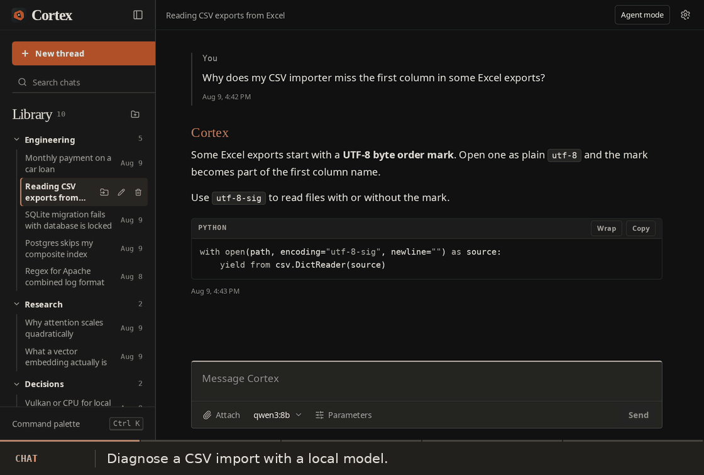

# Cortex

Cortex is a Windows desktop app for chatting with AI models and working on a
codebase. Run a model on your own hardware, pick up a conversation from your
local library, or give Agent mode a project to explore. You can review its
edits file by file before applying them.



The walkthrough uses a sample project and scripted model replies. [Still image of the workspace](.github/images/workspace.png)

## Run Cortex on Windows

Run the current desktop app from source. The published v1.0.0 release is the
earlier Qt app.

On Windows 10 or later, install Git, Python 3.11 or newer, a current Node.js
22 LTS or 24 LTS with npm, and the Microsoft Edge WebView2 Runtime. Open
PowerShell and run these commands.

```powershell
git clone https://github.com/dovvnloading/Cortex.git
cd Cortex
python -m venv .venv
.\.venv\Scripts\python.exe -m pip install -r requirements.txt
.\.venv\Scripts\python.exe main.py
```

The first launch installs frontend dependencies, builds the interface and opens
the desktop window. Choose a model in the message composer.

| Model source | How to connect |
| --- | --- |
| Ollama | Start Ollama on your PC. Cortex finds models served at `127.0.0.1:11434`. |
| GGUF file | Choose a models folder or download a GGUF from **Settings → System**. Cortex manages the llama.cpp runtime. [GGUF download notes](docs/user-guide.md#local-models-and-downloads) |
| Cloud provider | Open **Settings → AI Model → Cloud providers** to find your provider’s environment variables. Set them, restart Cortex and select a model. |

For a first local chat with Ollama, install a model in PowerShell, then choose
**Rescan** in the composer.

```powershell
ollama pull qwen3:8b
```

## In the workspace

- **Chat.** Attach a text file or image, copy a code block, or open the sources
  behind an answer when the model supplies them. Fork a reply to try another
  approach and keep the original thread.
- **Library and memory.** File related chats in groups. Press `Ctrl+K` to
  reopen a recent chat or switch models. When Cortex suggests a fact to
  remember, choose **Save** to keep it for later conversations.
- **Agent mode.** Turn on **Enable Agent mode** in **Settings → General**,
  save, and open **Agent mode** in the top bar. Choose a trusted folder and a goal, such as “Where
  does this app load its settings?” Start with **Plan only** for a read-through.
  For edits, Cortex works in a separate copy, shows the proposed changes and
  lets you confirm which files to apply to your project.

## How local execution is bounded

Chats and saved memories live on your PC. Choosing a hosted model sends the
assembled conversation, including attachments and enabled memories, to that
provider. Agent mode asks separately before sharing eligible project context.

When a local chat model proposes Python, the task tray shows the source and
requested access for your approval. The worker runs a restricted Python subset
and clears the environment variables it inherited, keeping only the Windows
system root. Agent mode has its own command approvals and Windows sandbox
limits. [Security and execution details](SECURITY.md)

## Project resources

[User guide](docs/user-guide.md) · [Contributing and development setup](CONTRIBUTING.md) · [Change log](Change_Log.md) · [MIT license](LICENSE)
